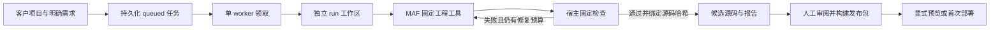

# P1：内置智能体首次开发与交付

P1 将客户项目中的需求、智能体执行、隔离检查、发布包和首次安装接入同一个开发工作台。实施人员创建项目、选择已配置的智能体并提交需求，后台任务在独立源码工作区内生成新业务模块，再由固定 Runner 检查。检查通过表示候选源码满足规定检查，还需要人工查看差异与报告、构建发布包，并显式启动预览或首次部署。

本阶段支持**新模块、基本字段、SQLite 首次安装和本机 Docker Linux 测试目标**。同一任务内可以修复本次新建文件；已有业务模块的跨任务增量修改、基线提升、不同版本升级和保留数据迁移属于 P2。成功任务不会自动覆盖客户项目基线。

[P0 历史契约](agent-delivery-p0.md)和[整体路线图](agent-delivery-roadmap.md)保留了前序约定；当前执行及运行方式以本文为准。

## 准备环境与启动工作台

需要 Go 1.26、Node.js 22.13+、pnpm 11.23.0，以及运行中的 Docker。固定检查镜像使用 Go 1.26.0、Node.js 22.22.3、pnpm 11.23.0。首次执行任务前，先在后端目录准备镜像：

```sh
cd server
go run ./cmd/fde prepare-image --output ./data/runner-image
```

镜像准备是明确的环境操作；任务无法提供自定义 Dockerfile 或任意宿主命令。首次准备镜像和下载项目依赖需要网络；后续编译、测试和构建使用固定步骤与隔离环境。

启动开发工作台：

```sh
# 在 server 目录；无子命令默认是 workbench
go run .

# 等价的显式入口
go run . workbench --config config.yaml
```

另一个终端启动前端：

```sh
cd web
pnpm install --frozen-lockfile
pnpm dev
```

`workbench` 才会初始化开发数据库、补齐开发菜单并启动后台 worker。`serve` 始终校验交付版本和已初始化数据库，即使配置中误填 `mode: debug`，也不会切换到工作台初始化。工作台入口拒绝 release 配置或发布 manifest；运行交付包应显式使用 `serve`。

工作台可配置独立目录：

```yaml
development:
  template-repo: ""             # 留空使用 codegen.server-dir 的父仓库
  template-ref: HEAD            # 建议固定包含 P1 能力的已提交版本
  workspace-dir: ./data/workspaces
  release-dir: ./data/releases
  target-dir: ./data/test-targets
  target-arch: arm64            # 按 Linux 目标选择 arm64 或 amd64
```

未配置 `target-arch` 时使用工作台进程的架构。客户项目只导出模板的已提交内容；未提交修改、运行数据库、日志、上传文件、缓存和宿主构建产物不会进入项目。使用正在开发的框架时，应先确保模板 commit 已包含所需 P1 代码。

## 在开发工作台完成一次任务

1. 在“AI 助手”中配置供应商、模型及启用的智能体。工程任务复用其模型和技能提示，但执行工具由宿主固定，不继承普通聊天绑定的任意工具或外部 MCP。
2. 进入“系统管理 → 开发工作台”，创建客户项目，填写项目标识与名称。项目从明确的模板 commit 导出独立源码仓库。
3. 选择客户项目、已配置的智能体，填写具体需求后提交。需求应包含字段、必填条件、列表/查询行为等可判断的结果。例如新增维修登记模块，包含登记号、问题描述、处理状态、负责人和登记时间。
4. 查看任务事件、源码差异、检查报告和执行结果。关闭或离开页面不会取消后台任务；需要停止时使用“取消”操作。
5. 任务检查通过后，先审阅实际 diff 和报告，再点击“构建发布包”。源码或报告不匹配时不能构建或复用原发布包。
6. 对已验证发布包点击“启动预览”，打开隔离应用并检查业务功能。预览有独立的运行数据目录。
7. 需要首次安装测试时，选择固定目标 `local-linux`，点击“部署此发布版本”并明确确认版本及目标。当前目标是在本机 Docker 中运行的 Linux 首次安装环境，不是任意客户服务器地址。

预览和部署首次建立的管理员凭据仅在对应成功响应中展示一次。页面提供复制入口；离开页面后不保留密码，请及时保存。后续请求未返回新凭据时，使用此前保存的账号。客户运行应用使用独立生成的初始化凭据，不复用工作台演示账号。

发布包安装、应用 readiness、业务 CRUD、必填校验、操作员 RBAC 和重启后数据保留是不同检查环节。界面中的“检查通过”“包已验证”“预览可访问”“部署完成”分别对应各自阶段。

## 后台执行及可信边界



- 创建任务需要 `requirement + agentId`。HTTP 入口校验用户及项目归属，worker 从持久化记录构造 RunScope；工具 JSON 无法指定或覆盖 actor、project、run、工作区。
- 数据库使用 queued 状态的单次领取，并按项目互斥。每个任务从项目基线导出自己的仓库，记录原基线和工作区初始 commit，目录位于项目源码之外。
- 固定工具为读取项目上下文、读取文件、搜索源码、生成业务代码、按文件 hash 修改源码、运行检查。写操作限于本任务允许的新业务源码及规格/安装资产；基线框架控制文件、已有业务文件、已有测试、配置、锁文件及运行数据受保护。
- 整个任务预算为 **30 分钟**。宿主允许首次实现后最多 **3 轮修复**，共最多 4 次实现/检查尝试；模型不能扩大预算、降低检查条件或自行决定成功。
- 任务和事件持久化。工具事件保留实际调用结果摘要，源码内容以长度和 hash 摘要记录；凭据字段脱敏。最终保存 diff、源码 hash、检查报告和结果。
- 显式取消会请求停止运行中的模型、工具和检查。服务重启将未完成任务标为 `interrupted`，保留工作区与证据，不自动重放写操作。
- 普通聊天及原生/MCP `apply_files` 继续遵守 P0 的人工确认约束。工程任务只能在已授权的 run 工作区自主编辑，不会借此写入工作台源码或客户运行数据库。

任务状态为 `queued`、`running`、`succeeded`、`failed`、`canceled`、`interrupted`。`succeeded` 的结果是待审阅候选；它不表示已经部署或获得客户业务验收。

## 固定检查与发布包

Runner 从当前任务源码建立检查快照，使用固定镜像和固定参数执行：

| 类别 | 检查 |
|---|---|
| 工具链 | Go、Node.js、pnpm 版本 |
| 依赖 | Go 模块下载、按锁文件安装前端依赖；禁用依赖安装脚本和 pnpmfile |
| 后端 | gofmt、Go 测试、Linux 服务端及 `fde` CLI 构建 |
| 前端 | Node 测试、TypeScript 检查、Vite 生产构建 |

报告包含实际退出码、日志引用、耗时、固定镜像身份、源码快照 hash，以及构建制品的 hash。宿主要求 `success=true`、检查报告与源码 hash 匹配、存在实际源码变更，并在检查后再次核对源码。模型的最终文字不能替代这些证据。

“构建发布包”使用已检查制品，不另行信任工作区里可被修改的二进制。发布清单绑定源码、检查报告、规格、安装资产、工具链、Linux 架构和各制品的 hash。预览、下载或安装前会重新验证发布清单。

工程生成器使用共享 `FormRender` 渲染业务表单。对应 schema 同时编译注册到后端，后端据此校验业务输入；安装资产的对象、表、菜单、组件与 schema 必须和编译注册一致。旧代码生成器模板仍保留兼容入口。

## 离线交付包与运行命令

版本目录包含：

```text
manifest.json
server                  # 已检查的 Linux 服务端
fde                     # 已检查的 Linux 安装/检查 CLI
web/                    # 已构建前端
assets/business.json    # 固定业务安装资产
spec/                   # 业务规格
requirements/           # 本次需求记录
reports/checks.json
config.example.yaml
LICENSE
```

下载包可用于匹配架构的 Linux 环境。`fde install` 检查包并布置版本目录、共享数据目录和配置示例；需要继续完成配置、首次初始化及运行验证。CLI 不接受任意 shell 命令。

以下命令在 `server` 目录中执行。将路径和 `SOURCE_SHA256`、`CHECK_REPORT_JSON` 替换为实际输出；检查输出目录必须位于源码工作区之外。

```sh
go run ./cmd/fde snapshot --workspace /absolute/customer-run

go run ./cmd/fde check \
  --workspace /absolute/customer-run \
  --output /absolute/check-output \
  --snapshot SOURCE_SHA256 \
  --arch arm64

go run ./cmd/fde pack \
  --workspace /absolute/customer-run \
  --checks CHECK_REPORT_JSON \
  --output /absolute/release-packages

go run ./cmd/fde inspect --package /absolute/release-packages/RELEASE_ID
```

在匹配架构的 Linux 首次安装目标中使用包内 CLI：

```sh
./fde inspect --package /absolute/release-package
./fde install --package /absolute/release-package --target /opt/customer-app
```

依据安装结果中的配置示例建立目标配置，填写明确的强随机 JWT 密钥、管理员及初始化密码，并使用独立 SQLite 文件。随后通过安装后的版本路径执行：

```sh
/opt/customer-app/releases/RELEASE_ID/server bootstrap \
  --config /opt/customer-app/shared/config.yaml \
  --assets /opt/customer-app/releases/RELEASE_ID/assets \
  --manifest /opt/customer-app/releases/RELEASE_ID/manifest.json

/opt/customer-app/releases/RELEASE_ID/server verify \
  --config /opt/customer-app/shared/config.yaml \
  --manifest /opt/customer-app/releases/RELEASE_ID/manifest.json

/opt/customer-app/releases/RELEASE_ID/server serve \
  --config /opt/customer-app/shared/config.yaml \
  --manifest /opt/customer-app/releases/RELEASE_ID/manifest.json \
  --web /opt/customer-app/releases/RELEASE_ID/web
```

`bootstrap` 只接管空数据库，或恢复与本次安装日志、规范数据库路径及数据库自身 marker 一致的未完成安装。更改 DSN 不能复用原日志接管其他非空库。业务资产在任何迁移之前完成编译注册校验；完成业务初始化和权限重建后才标记安装完成。

`verify`、普通 `serve` 和 readiness 只校验已安装版本；不会运行 AutoMigrate、seed 或开发菜单补齐，也不会启动开发 worker。首次初始化必须通过显式 `bootstrap` 完成。

## 当前范围

- P1 面向单实例工作台和本机 Docker Linux 首次安装测试；尚未实现远程 SSH、云环境或容器编排部署。
- 自动生成支持 `string`、`text`、`int`、`float`、`bool`、`datetime` 基本字段；关系、枚举、联动、字典依赖以及复杂工作流不属于本阶段自动交付承诺；遇到这些草稿会明确停止生成，避免丢弃业务规则。
- 本次任务可修复自己的新建模块；已有业务代码、已有数据结构的增量变更、不同发布版本升级及数据迁移留待 P2。
- 首次交付运行数据库仅支持 SQLite。框架工作台原有的 PostgreSQL 配置能力不代表 P1 发布升级矩阵已经完成。
- 测试中的本地脚本网关用于稳定复现 MAF 工具链、修复和失败路径。它不能证明真实付费模型的需求理解质量，也不代表客户生产环境已经验收。

## 验证命令与记录

2026-11-06 已完成本地验收：

| 验证 | 结果 |
|---|---|
| 后端 | 全包 race 测试、vet、build 通过 |
| 前端 | 17 条回归、TypeScript 检查与 Vite 生产构建通过 |
| 真实执行链 | 本地脚本网关驱动真实 MAF 工具，创建“维修登记”；注入 Go 编译错误后，第二轮修复并通过全部 12 项隔离检查 |
| 首次交付 | 同一已验证 Linux/arm64 制品完成安装、bootstrap、verify、serve；目标中不安装 Go/Node |
| 业务 | CRUD、必填校验、前后端字段名一致的筛选、普通业务角色可操作且系统用户接口拒绝访问 |
| 重启 | 固定本机端口保持可用，原业务数据保留 |
| 浏览器 | 任务/事件/diff/报告恢复，认证 ZIP 下载、独立预览登录与业务操作、401 失败任务禁用发布均通过 |

复核样例的候选版本：`cab79680-bd5a-4526-ad7d-11350b7ffceb`；源码快照 SHA256 为 `9cf1b83e8aed733358f91e247576b6951dabb108764cbf1a489c8b54d2adcb2e`，发布清单 SHA256 为 `a869da3f3c35ecaf6ef96eba04627a6d1c309de35d1372e0c63dda21105b62cb`。需求快照、规格、检查报告和文件校验和随版本包保存。

以上验证使用模拟模型协议输出，实际执行工具、编译测试、安装及 HTTP 业务操作；没有调用付费模型，也没有部署客户生产环境。

```sh
# 常规后端验证（server 目录）
go test -race ./...
go vet ./...
go build ./...

# 常规前端验证（web 目录）
node --test tests/*.test.mjs
node node_modules/vue-tsc/bin/vue-tsc.js --noEmit
node node_modules/vite/bin/vite.js build

# 重型 Docker 首次交付验收（server 目录）
go run ./cmd/fde prepare-image --output /tmp/fde-runner-image
FDE_RUN_DOCKER_ACCEPTANCE=1 go test ./internal/service \
  -run '^TestDevelopmentDockerFirstDelivery$' -count=1 -v -timeout 35m
```

CI 的常规 push/PR 执行 Go race、vet、build 和前端测试、类型检查、构建。工作流进入默认分支后，需要重跑重型端到端时，手动触发 `Framework checks` 的 `workflow_dispatch`，将 `docker_acceptance` 设为 `true`。
