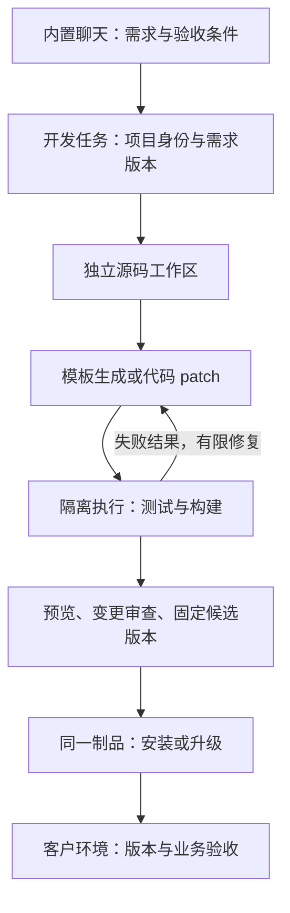

# 内置智能体业务开发与交付改造计划

制定日期为 2026-11-06，规划基线为 `ee9b905`。本文保留分阶段目标和后续范围，当前实现及复测记录见 [P1 首次开发与交付](agent-delivery-p1.md) 和 [P2 增量开发与 SQLite 升级](agent-delivery-p2.md)。

目标：实施人员带着框架到客户现场，在内置智能体中完成需求描述、业务代码生成、已有业务修改、测试修复、预览验收、打包部署，并能保留业务数据再次交付。

首要里程碑有两个：**P1 完成一次从需求到测试环境部署；P2 完成保留 V1 数据和自定义代码的 V2 升级。** P0～P2 是优先实施范围，复杂业务扩展和更多交付环境在其后推进。

## 1. 当前基础与需要消除的断点

| 当前实现 | 改造要求 | 代码切入点 |
|---|---|---|
| 内置 MAF 智能体可调用 Go 工具与 MCP；技能通过提示词注入 | 保留现有执行框架，补工程工具、任务状态和项目上下文 | [ai.go](../server/internal/service/ai.go)、[tool_registry.go](../server/internal/service/tool_registry.go) |
| 模板生成六类前后端文件，菜单和权限写入当前连接的数据库 | 生成到客户源码工作区；目标库的菜单、权限、Schema 初始化随版本交付 | [codegen.go](../server/internal/codegen/codegen.go)、[codegen_business.go](../server/internal/service/codegen_business.go) |
| 已有表或同名菜单直接返回冲突 | 区分首次创建、受管理对象增量、未接管的旧代码，不能直接移除冲突检查 | [generateBusinessCode](../server/internal/service/codegen_business.go) |
| diff 会报告文件冲突，apply 尚未校验文件基线；旧生成接口还有独立写盘流程 | 统一变更执行入口，按旧文件 hash 检查，保护人工修改 | [codegen_business.go](../server/internal/service/codegen_business.go)、[旧生成路径](../server/internal/service/codegen.go) |
| Schema 保存时存在类型转换与规则遗漏，保存即发布；FormRender 只用于预览 | 修复保存往返，拆分草稿与激活版本，将 FormRender 用到生成业务页面 | [表单编辑页](../web/src/views/system/formgen/index.vue)、[formgen.go](../server/internal/service/formgen.go)、[templates.go](../server/internal/codegen/templates.go) |
| 生成工具使用 userID=0；模型可填写 approve，dryRun=false 会内部自动批准 | 使用服务端执行身份；工作区内自主开发与版本发布分别授权 | [codegen_business.go](../server/internal/service/codegen_business.go) |
| 当前聊天主要保存文本，并裁剪历史 | 保存需求、规则、工具结果、变更、测试和交付证据，形成项目上下文 | [AI 消息模型](../server/internal/model/ai.go)、[聊天执行](../server/internal/service/ai.go) |
| 启动时统一 AutoMigrate，部署主要依靠人工开发命令 | 显式初始化与版本迁移、验证制品、安装验收、兼容回退 | [init.go](../server/internal/initialize/init.go)、[fde.sh](../fde.sh) |

## 2. 实施方案与约束

### 2.1 开发工作台与客户运行环境

复用 Go、Vue、MAF、RBAC、现有生成器和表单渲染器。首先增加同一仓库中的少量模块及一个后台 worker，不拆成多套独立服务。



- 工作台管理源码与开发任务；客户环境运行已经构建的版本。客户运行目录不作为智能体源码写入位置。
- 首个部署目标固定为 **Linux 单机、SQLite、版本目录中的 Go 二进制与前端静态资源**。由后端提供静态资源与 SPA 回退，统一访问入口。
- 开发验证默认在一次性容器内运行，固定 Go、Node、pnpm 版本。工作区只隔离文件，执行隔离还需要受控进程、环境变量和挂载策略；客户机不因此需要 Docker。
- 使用现有数据库记录任务，首版一个 worker；同一客户项目和同一部署目标分别加互斥锁，避免并发覆盖或重复升级。
- 用户发起项目开发任务后，智能体可在该工作区内自主编辑、运行测试和有限修复。提升候选版本、部署及不兼容数据迁移使用独立的明确授权。
- 交付环境默认关闭工程写盘和构建入口；客户业务若需要 AI 功能，可继续启用业务智能体。

### 2.2 元数据、源码与发布版本的关系

沿用业务对象驱动表单的现有设计，补充版本生命周期：

1. `sys_biz_objects/sys_biz_fields` 保存工作台中的声明式业务草稿：字段、规则、枚举、关系、查询、列表和表单配置。
2. 每次生成冻结不可变的业务规格快照，保存到客户项目的 `fde/spec/`，记录 spec version/hash 和模板版本。生成器从同一快照投影文件及表单 Schema。
3. 复杂业务动作由 Go/Vue 自定义源码及业务验收用例表达。元数据不承担任意代码的反向同步。
4. 发布清单固定源码 commit、spec hash、迁移版本、active Schema 版本、测试结果及制品 hash。目标数据库从这些发布资产初始化或升级，不能复制工作台数据库交付。
5. 静态 Vue 页面壳负责列表、详情和业务动作，普通字段表单统一使用现有 `FormRender`。字段校验同时在后端执行，不能只校验页面。
6. 编辑产生 draft；后端、数据结构和 Schema 一致后再激活。展示文字、排序等兼容 UI 调整可在 P2 支持独立发布；字段、类型、约束和关系变化必须进入完整变更集。

以上补充了 [原表单与代码生成设计](form-codegen-design.md) 的发布过程，保留其动态表单与统一业务对象方向。旧文档的 P1～P4 是已有表单项目阶段，与本文改造阶段分开编号理解；本文以实际代码基线为准。

### 2.3 最少的工程接口与记录

| 模块 | 对调用者提供的 Interface | 首次引入阶段 |
|---|---|---|
| Workspace | 从指定模板/源码 commit 创建工作区、读取受限文件、导出 diff、保留或清理任务目录 | P0～P1 |
| ChangeSet | 从冻结规格生成计划、按 expectedHash 应用 patch、记录文件所有权及迁移/菜单计划 | P0～P2 |
| Runner | 执行固定检查配置、保存退出码与日志、产出构建与预览结果 | P1 |
| Delivery | 构建并验证发布包、安装、升级、验收、按兼容条件切回旧版 | P1～P2 |

这些是同一工程内的 Module，不要求独立进程或为每个模块预设多种 Adapter。CLI、内置工具和 MCP 应调用相同实现。

任务记录至少包含：projectID、actor、需求版本、baseCommit、workspaceID、当前 phase、工具调用与结果引用、patch/spec hash、检查结果、制品及发布记录。可关联或扩展现有 `GenAudit`，避免维护两套不一致的变更账本。

任务状态采用 `queued → running → succeeded`，另有 `awaiting_approval / failed / canceled / interrupted`；步骤使用 `plan / edit / verify / review / release`。开发验证成功与部署成功分别记录，不能用一条助手文本代替实际发布状态。

- SSE 展示已持久化事件；关闭浏览器不取消后台任务，用户显式停止才取消可中断步骤。
- worker 重启后将未完成任务标为 interrupted，检查工作区、迁移记录及目标版本后恢复；写操作不盲目重放。
- 一次性授权绑定项目和操作范围。发布授权绑定候选源码、规格、制品摘要、测试结果及部署目标；发生变化时旧授权失效。
- 工具身份由服务端传入，模型参数不能指定 actor、绝对工作目录或批准人。外部 MCP 写工具须有明确的项目主体和授权映射，未完成映射时只提供预览/只读能力。

## 3. 分阶段计划

### P0：修复基础契约，建立统一的开发执行入口

**成果：** 项目具有可靠的业务规格输入和可追踪的工作区变更，新增工程能力可以在同一入口受控执行。

交付项：

- P0-1 修复 Schema 保存往返：业务字段类型与 JSON Schema 类型正确转换，保留 rules、enum、relations、linkages、查询/列表/表单标记和 UI 配置；保存与重新拉取语义一致。
- P0-2 拆分 draft 与 active Schema。草稿保存不改变当前运行页面；版本校验失败保持旧 active。
- P0-3 把旧 `/api/codegen/generate`、对象生成、`apply_files` 和 MCP 写入口收敛到同一变更执行入口。去掉内部自动批准与匿名 userID=0 执行，检查用户、会话、项目归属及工具权限。
- P0-4 为文件计划记录 expectedHash；预览后文件变化或存在未解决冲突时拒绝覆盖，保留 diff 与恢复快照。工作区路径需拒绝越界、符号链接逃逸及非授权目录。
- P0-5 建立项目、任务和步骤记录；工作台业务对象按 `projectID + objectKey` 复合唯一并按项目查询，旧记录归入明确的默认项目，避免跨客户草稿冲突。模板从明确 commit 导出干净文件，修复 `fde.sh` 对日志、上传、数据库、bin、缓存及备份目录的复制问题。
- P0-6 固定运行约定和初始验收样例，校准工具链、依赖安装、测试 Linux 环境，以及迁移工具选择。迁移执行复用成熟方案，不在此阶段设计通用跨数据库迁移语言。

验收：Schema 往返不丢规则；草稿不影响 active；所有写入口使用相同身份与文件基线检查；并发/过期变更被明确拒绝；新客户工作区无任何旧客户运行数据。

### P1：内置智能体完成首次生成、测试与部署

**成果：** 从内置聊天生成一个新模块，并部署到干净测试 Linux。此阶段就交付完整纵向流程。

交付项：

- P1-1 工程上下文包含需求、规则、验收案例、代码结构与当前 diff；需求和约定保存到项目文件，避免只依靠裁剪后的聊天。
- P1-2 注册最少工程工具：`read_project_context`、`search_code`、`read_file`、`generate_business_code`、`apply_patch`、`run_checks`、`get_run_result`。文件操作限定工作区相对路径，检查任务使用固定 profile，不开放任意 shell 字符串。
- P1-3 现有六类模板改为生成到工作区，普通字段表单统一复用 FormRender。首版即记录文件所有权、原始生成 hash 和 patch 后版本；服务/页面壳只创建一次，为 P2 再生成建立基线。必填、类型、基础长度/范围规则同时在后端执行。生成计划导出 Schema、菜单、按钮与角色映射，角色通过稳定 code 解析目标库 ID；这些初始化在预览库和目标库执行，不能只写到工作台的 `sys_menus`。表/菜单冲突检查针对客户项目的规格、文件与预览库，不能以工作台当前 `global.DB` 代替目标状态；不同客户项目可以使用相同业务对象名。
- P1-4 Runner 实际运行 Go 格式检查、`go test ./...`、`go build`、前端类型检查和生产构建，保存退出码及完整日志引用；首批加入生成后 API 与浏览器 CRUD 验收。
- P1-5 检查失败回传智能体，最多自动修复 3 轮，并受总耗时/用量预算约束。不得通过删除验收测试、放宽断言或跳过检查来通过；耗尽后保留候选代码与诊断。
- P1-6 生成版本包、预览实例和部署操作。首版只允许空业务库首次安装；显式 bootstrap 可复用 AutoMigrate，并承担 seed、ensure 菜单/工具、角色与授权初始化，普通运行启动只加载和检查预期结构及发布元数据。目标机在持久目录记录 `installId + releaseId + started/completed` 安装日志，全部初始化完成才写完成标记；部分失败仅允许同一安装任务核对已完成步骤后幂等续作，其他非空库拒绝直接接管。所有操作使用包内目标平台二进制，不依赖源码或 `go run`。
- P1-7 客户端显示任务步骤、diff、测试结果、预览地址、制品与实际发布状态；补 release 版本信息和数据库/结构版本 readiness。
- P1-8 在 GitHub CI 中复用同一检查 profile。自动化使用 mock 模型验证工程协议；真实模型的试运行单独执行并保留结果，不让每次 CI 依赖付费模型或客户账号。

验收样例：新建未与 `customer/product` 重名的“维修登记”（如 `biz_repair_ticket`），字段包含登记号、描述、创建时间、处理状态及负责人。由内置智能体完成：

1. 生成业务与验收代码，在独立数据库启动后看到新表、新路由、页面和菜单。
2. 验证新增、查询、编辑、删除，直接 HTTP 提交非法字段被拒绝，以及普通角色无权限时拒绝操作。
3. 注入一次编译错误，智能体读取真实失败结果并修复，重新通过完整检查。
4. 将同一已验证发布包安装到测试 Linux；移走源码和 Go/Node 后仍能安装运行。注入初始化中途失败，使用同一安装任务续作成功，普通启动通过校验；浏览器完成业务操作，服务重启后数据仍在。
5. 任务记录能关联需求、源码、测试结果及发布版本；不需要人在编辑器补代码或手工改数据库。

**里程碑 M1：首次业务交付完成。** 允许在指定单机测试环境演示；仍不能宣称已支持已有客户系统的升级。

### P2：保留数据与自定义代码的增量修改

**成果：** 对 P1 已部署业务提出新需求，由同一内置智能体完成 V2 修改、验证和升级。

交付项：

- P2-1 业务对象增加 `create/update` 计划与 baseSpecVersion；对比已发布 V1 和候选 V2，产出规格差异、文件 patch、数据库迁移、Schema 及菜单权限增量。
- P2-2 扩展 P1 的生成文件 manifest：模板维护 `*_gen.go / *.gen.ts / schema` 等文件；业务服务和专用 Vue 页面壳只在首次创建时初始化，之后通过 patch 修改。再生成前校验文件基线及所有权，P1 中被 patch 过的生成文件先识别为冲突，不能据模板原始 hash 直接覆盖；未接管文件默认不覆盖。
- P2-3 扩展枚举投影、新增约束与前后端校验一致性；先支持新增可空字段、明确默认值和回填、可预检的约束/索引。重命名、删除、类型缩窄和不可逆转换先生成专项迁移方案，未经单独授权不自动执行。
- P2-4 增加版本化迁移、校验和、执行记录、单目标迁移锁与失败状态。已发布迁移不得修改；重复执行不能重复回填或重复创建菜单。
- P2-5 已有库先在副本上验证基线，再迁移；新表和升级都进入显式安装/迁移流程。开发模式的 AutoMigrate 可保留，客户运行模式只校验已部署版本。系统表与旧示例通过基线接管渐进迁移。
- P2-6 升级前在数据副本上预演，进入维护窗口后停写、备份、升级、验收再恢复写入。数据备份包含数据库及关联上传文件的一致性说明。
- P2-7 激活完整的后端/前端/Schema 版本组合；支持兼容 UI 变更单独发布，记录兼容性范围。菜单、按钮与授权增量也保存版本及前后值，回退只补偿本次变更，保留无关的客户授权调整；同一项被另行修改时报告冲突并停止自动补偿。工作区文件快照、应用回退、数据库恢复分别记录。
- P2-8 `customer/product` 旧样例保持可用并标记 legacy；只有显式导入和核对基线后才纳入增量管理，不能凭名称自动接管。

验收：

1. V1 中预置不少于 20 条测试业务记录，并通过普通 patch 添加一条自定义校验。
2. 由聊天要求新增 `priority=normal/urgent`，将历史记录回填为 normal；同时修改列表、表单及服务端校验并生成迁移。
3. 副本预演与完整测试通过后升级 V2；旧记录的 ID、登记号和关联信息保留，自定义校验与人工修改保留，新字段前后端一致。
4. 再次执行同一升级不产生重复副作用；预览后修改文件会触发基线冲突，不能被覆盖。
5. 注入构建失败、迁移失败、启动失败，分别观察正确状态和恢复动作；回退后菜单、按钮与授权和目标版本一致，无关授权调整保留；不兼容数据库不能仅通过切回旧代码被标记为恢复成功。升级操作同样不依赖目标机源码或 Go/Node。

**里程碑 M2：生成 → 增量修改 → 测试修复 → 部署升级的核心流程完成。** 此时再决定扩展业务复杂度和客户环境支持范围。

### P3：用一个真实业务流程验证通用编码能力

**成果：** 智能体可在模板起步后阅读和修改自定义业务逻辑，正确处理跨表规则。

交付项：

- P3-1 增加 many-to-one 关联、主从明细的规格与生成支持；关联查询、选择控件、后端引用校验及所需索引一起交付。
- P3-2 生成的数据访问函数接受数据库/事务实例；业务服务负责事务和规则，避免主从操作分别落到不相关的 `global.DB` 调用。
- P3-3 固定样例为“客户 + 服务工单 + 工单明细”：draft → submitted → completed，含非法状态转换拒绝、主从保存事务、重复提交幂等、两种角色和数据归属。
- P3-4 对新规则增加验收测试，允许智能体修改服务、路由和专用页面；业务规则以明确代码与测试表达，表单 Schema 仅管理字段和基础联动。
- P3-5 在现有自定义规则上再次变更，例如“已提交工单不能删除，完成时必须填写处理结果”，验证原行为、数据和权限不回归。

验收：重复提交没有重复明细；保存中途失败主从一致；无权限及跨归属访问被拒绝；同一内置智能体完成第二轮业务逻辑修改和发布，测试能够实际发现规则遗漏。

### P4：客户现场可靠交付与产品化验收

**成果：** 在明确支持的客户环境完成安装、升级、恢复及运维移交。

交付项：

- P4-1 PostgreSQL 完整通过首次安装、V1→V2、约束、数据回填、备份与恢复矩阵；P1 起保留 PostgreSQL 基础冒烟，达到此验收后再承诺完整 PG 交付支持。
- P4-2 提供环境预检、配置模板、服务管理、日志定位、备份保留策略及恢复操作；生产初始化使用明确的管理账号配置，不能沿用演示密码和开发密钥。
- P4-3 导出可在断开公网的干净测试机安装运行的制品包，包含所需运行资源及校验清单；客户机无需 Go、Node、pnpm。客户 TLS/域名与外部系统配置按具体交付环境记录。
- P4-4 需要现场开发时，再提供固定工具链、依赖缓存和构建环境预检。模型连通性单独校验；离线安装运行不代表智能体可离线推理。
- P4-5 形成交付包：源码与 LICENSE、需求/规格、数据库迁移、测试报告、发布清单、配置示例、安装升级及恢复手册、业务验收记录。真实客户配置和凭证与公开仓库分离。
- P4-6 固定 10 个试运行任务，包含首次创建、字段变更、自定义逻辑、迁移与发布失败；记录成功率、修复轮次、人工补代码次数、耗时、模型用量及恢复结果。

建议验收门槛：固定业务链在干净环境连续 3 次通过；10 个预定义任务至少 8 个在 3 轮修复预算内完成，其余准确停止并保留可复现诊断；数据丢失、未授权发布、错误宣告交付成功均为不通过项。这些是拟定目标，不是当前能力或性能结论。

## 4. 统一的测试与发布约定

### 4.1 检查逐层增加，P1 就接入自动反馈

| 检查层 | 内容 | 最早阶段 |
|---|---|---|
| 规格与变更契约 | Schema 往返、合法字段、文件基线、身份和权限、草稿/发布状态 | P0 |
| 源码验证 | Go 格式检查、测试、编译，Vue 类型与生产构建 | P1 |
| 生成后运行 | 空库安装、模型/路由/菜单/权限生效，真实 HTTP 与浏览器 CRUD | P1 |
| 增量兼容 | 带数据 V1→V2、自定义代码保留、迁移重入、中断与恢复 | P2 |
| 业务流程 | 主从事务、状态机、幂等、权限与数据归属 | P3 |
| 交付矩阵 | 干净 Linux、SQLite/PG、离线安装、实际备份恢复 | P4 |

固定检查由项目约定和验收规格决定；智能体可以补充测试，不能自行降低既定门槛。先测试可观察业务行为和故障恢复，不为每个模板字段重复堆相同单测。

### 4.2 发布包与数据分离

```text
release/<releaseId>/
  server                 # 已验证的目标平台二进制
  fde                    # 安装、校验、迁移、备份与恢复所用的目标平台 CLI
  web/                   # 已构建前端
  manifest.json          # 源码/spec/迁移/Schema/工具链/目标架构/文件校验和
  fde/spec/              # 冻结规格与菜单权限计划
  migrations/            # P2 起的版本化迁移
  reports/               # 测试、预演和构建记录
  config.example.yaml
  install、start、status、upgrade、rollback 等操作入口

shared/
  config/ data/ uploads/ log/ backups/
```

发布仅安装已经验证过的同一份制品；部署时不能重新生成或重新构建。数据、配置和上传文件放在版本目录之外。发布后校验版本标识、数据库与迁移版本、Schema、前端资源和至少一个真实业务操作，不能只检查进程存活。

### 4.3 回退策略必须区分失败位置

| 失败位置 | 对客户环境的处理 |
|---|---|
| 工作区生成、测试、构建、副本预演失败 | 保留现运行版本与业务库，修复候选工作区 |
| 新应用失败，数据库与旧版兼容 | 切回旧二进制、前端与 active Schema，补偿本次菜单/按钮/授权增量，保留现有业务数据及无关授权调整 |
| 数据结构已不兼容旧版 | 保持停写，选择向前修复或恢复指定备份；需要单独的恢复确认 |
| 发布进程中断，结果不明确 | 读取迁移记录、目标版本、制品校验与步骤记录后对账，禁止直接重放发布 |

数据库恢复可能丢弃备份之后的写入，不能由健康检查失败无条件触发。首版采用维护窗口保证迁移、验收和必要恢复期间没有新业务写入；P2 必须完成真实恢复演练。

SQLite 使用经当前驱动验证的一致性备份方法，不能在写入时裸拷贝单个数据库文件。PostgreSQL 升级前导出需验证恢复、角色与权限依赖；升级前备份不能替代长期数据库备份策略。依据见 [SQLite 备份说明](https://www.sqlite.org/backup.html) 和 [PostgreSQL pg_dump 文档](https://www.postgresql.org/docs/current/app-pgdump.html)。

## 5. 执行顺序与工作拆分

关键依赖：

```text
规格往返/草稿状态 ─┐
身份/统一执行入口 ─┼→ P1 工作区生成 → 自动检查/修复 → 首次部署 M1
文件基线/项目上下文┘                          ↓
                         P2 源码所有权 + 迁移 + 带数据升级 M2
                                                ↓
                             P3 真实业务规则 → P4 客户交付矩阵
```

建议首批按以下顺序拆成可独立审查的变更；阶段任务编号见上文：

| 顺序 | 变更包 | 完成后可验证的结果 |
|---|---|---|
| 1 | P0-1～2：规格输入与生命周期 | 编辑、保存、重新读取语义一致；草稿不会发布 |
| 2 | P0-3～4：统一执行与变更基线 | 旧接口、内置工具、MCP 使用同一写入规则；过期变更无法覆盖 |
| 3 | P0-5～6：项目工作区与任务骨架 | 从干净模板创建项目，任务、身份、文件计划可追踪 |
| 4 | P1-1～3：内置工程工具与可运行生成 | 内置聊天生成新业务；独立预览库有页面、路由、菜单和权限 |
| 5 | P1-4～5、P1-8：检查与修复 | 编译/业务测试失败反馈，有限自动修复；CI 使用同一检查 |
| 6 | P1-6～7：首次制品交付 | 干净 Linux 安装运行、版本与业务验收，达成 M1 |
| 7 | P2-1～5：增量与迁移 | 保留自定义源码和已有数据生成 V2 候选 |
| 8 | P2-6～8：升级及恢复 | 带数据升级、故障恢复和 legacy 兼容，达成 M2 |

规格输入和执行入口可并行开发；首次打包可与 Runner 并行。增量迁移依赖文件基线和业务规格冻结，真实客户升级依赖副本预演、备份恢复及发布状态对账。

阶段完成按验收证据判断，不按“工具已注册”或“页面已出现”判断。工期在 P0 明确团队、模型与测试环境后，按上述变更包逐项估算；P1 首次闭环的实测数据用于校准后续工作量。

## 6. 实施文件地图与决策依据

| 位置 | 主要职责 |
|---|---|
| `server/internal/service/ai.go`、`tool_registry.go` | 执行身份、任务上下文、工具注册、结果回传 |
| `server/internal/service/codegen*.go` | 统一 ChangeSet 与 workspace 输出、冲突和基线检查 |
| `server/internal/codegen/` | 规格投影、生成/自定义文件所有权、FormRender 页面壳 |
| `server/internal/service/formgen.go`、`model/formgen.go` | 草稿、冻结规格、版本与激活生命周期 |
| `server/internal/workspace/`、`runner/`（新增） | 工作区管理、固定命令配置、隔离执行和日志 |
| `server/internal/delivery/`、`migrate/`（新增） | 版本包、安装升级、迁移、健康验收和恢复 |
| `server/cmd/fde/`（新增） | 人工操作与内置工具共用的本地/目标机命令入口 |
| `server/internal/initialize/init.go`、`router/router.go` | 初始化与运行检查分离、版本与 readiness |
| `web/src/views/system/ai/session/` | 现有聊天内展示开发任务、diff、检查及发布结果 |
| `web/src/views/system/formgen/`、`components/form-render/` | 规格编辑往返、草稿/active 展示、业务表单复用 |
| `fde.sh`、CI 配置、交付脚本（后两项新增） | 干净项目导出、同源检查和可复现打包 |

以下官方资料用于核对工程设计，具体接入仍需按仓库锁定的依赖版本验证：

- 工具审批采用请求、明确响应与恢复执行的模式，应用需校验授权与候选动作的绑定关系：[Microsoft Agent Framework 工具审批](https://learn.microsoft.com/en-us/agent-framework/agents/tools/tool-approval)。不能假设当前依赖版本已替项目实现这一层。
- AutoMigrate 可以调整部分结构，但发布升级仍需明确的版本化迁移和数据转换：[GORM 迁移说明](https://gorm.io/docs/migration.html)。
- 若后续增加 Compose 部署，应将生产配置、持久数据与不可变应用代码分开，并重新验证对应制品：[Docker Compose 生产部署](https://docs.docker.com/compose/how-tos/production/)。首个交付实现仍采用前述单机版本包。

本文只制定改造范围和验收方式；实施时每个变更包补充对应设计、测试与迁移证据。优先完成 M1、M2，再以真实客户试运行结果调整 P3、P4。
