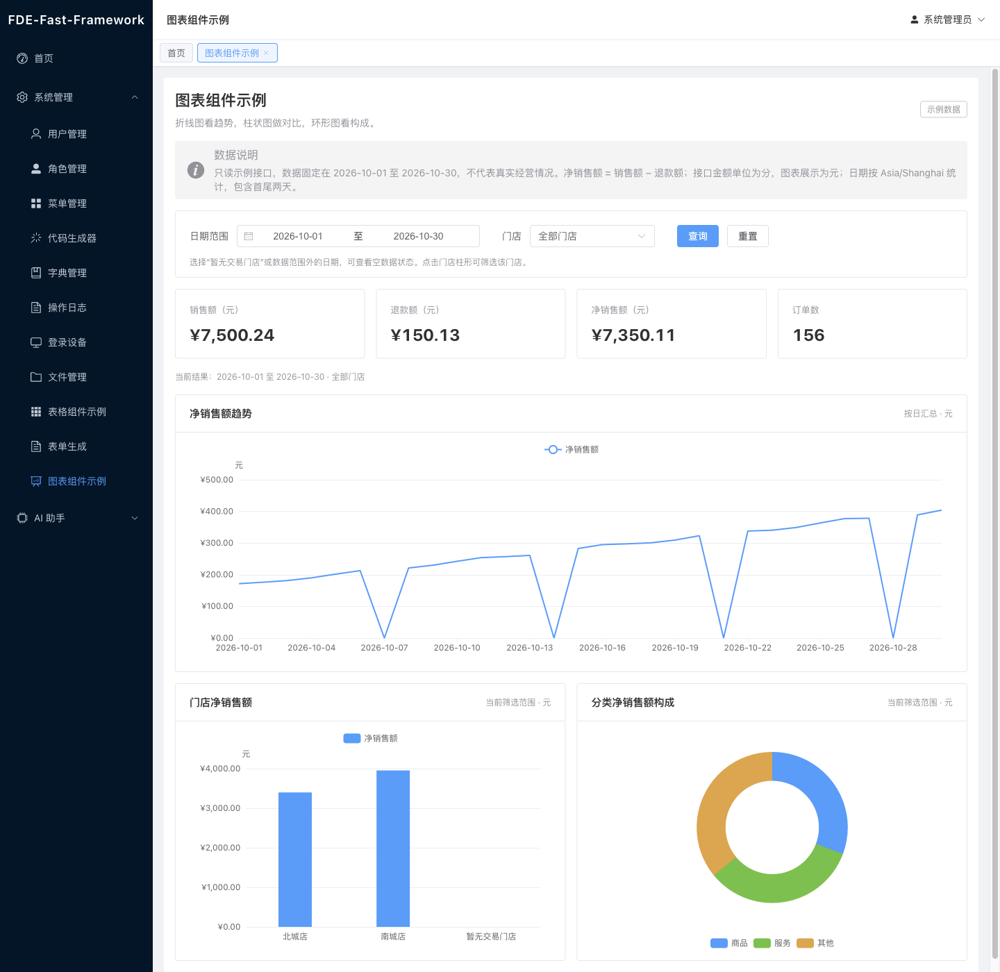

# ECharts 图表组件与生成技能

图表使用 Apache ECharts。页面通过 `BaseChart` 管理实例，通过 `option` 保留 ECharts 配置能力；常用配置函数只组织展示，不请求接口、不计算业务统计。

## 组件入口

```ts
import {
  BaseChart,
  createLineOption,
  createBarOption,
  createDonutOption,
} from '@/components/charts'
import type { EChartsOption } from '@/components/charts'
```

`BaseChart` 属性：

| 属性 | 类型 | 用途 |
|---|---|---|
| option | EChartsOption | 完整配置，数据改变后更新图表 |
| height | number / string | 默认 320；数字单位为 px |
| loading | boolean | 请求中的加载状态 |
| empty | boolean | 当前查询无数据，由接口结果决定 |
| error | string | 失败说明；显示重试按钮 |
| ariaLabel | string | 图表的可访问名称 |

事件：`click` 传出 ECharts 点击参数，`ready` 传出实例，`retry` 请求页面重新加载。通过组件 ref 可调用 `getInstance()` 和 `resize()`。容器尺寸观察、激活恢复、卸载销毁由组件处理。优先使用声明式 `option`，直接操作实例时由调用方维护一致性。

页面传入显式 `empty`，避免把数值 0 判断成无数据。加载、错误和空数据时不展示旧图表结果；请求失败保留筛选条件。数据请求及并发结果控制属于页面，后发请求的结果优先。

## 三个常用配置

折线与柱状图共用输入形状：

```ts
const option = createLineOption({
  categories: report.trend.map((item) => item.date),
  series: [{
    name: '净销售额',
    data: report.trend.map((item) => item.netCents / 100),
  }],
  valueName: '元',
  valueFormatter: (value) => `¥${value.toFixed(2)}`,
})
```

将 `createLineOption` 替换为 `createBarOption` 可展示分类对比。序列值支持 `null` 表示缺测；是否补 0 由统计口径决定。

构成图使用：

```ts
const option = createDonutOption({
  data: report.composition.map((item) => ({
    name: item.categoryName,
    value: item.netCents / 100,
  })),
  seriesName: '净销售额',
  valueFormatter: (value) => `¥${value.toFixed(2)}`,
})
```

页面可以继续修改返回的 `option`，例如图例位置、轴标签、缩放和标记线。基础注册集中在 `web/src/components/charts/runtime.ts`；使用其他图表类型或组件时，通过 `@/components/charts` 导出的 `registerCharts()` 注册对应 ECharts 模块。普通饼图可直接使用 `type: 'pie'` 配置并调整 `radius`。

选择图表时：时间趋势用折线图，分类对比用柱状图，非负数值的整体构成可用饼/环形图。包含负值或无法形成有意义总量时，使用柱状图等表达；百分比需要明确分母。ECharts 开启 ARIA 后仍应提供页面摘要，重要数值可以额外提供表格。

## 可运行统计示例

启动后在“系统管理 → 图表组件示例”进入页面。新增菜单在后端启动时补齐，已登录会话需要重新拉取菜单（退出再登录）。



- 页面：`web/src/views/demo/charts/index.vue`。
- API 封装：`web/src/api/chart-demo.ts`。
- 接口：`GET /api/demo/charts/sales`，使用现有 JWT 和 Casbin 权限。
- 参数：`startDate`、`endDate` 为 `YYYY-MM-DD`；`storeId` 空字符串表示全部门店，`north`、`south` 和 `empty` 为示例门店。
- 默认日期：2026-10-01 至 2026-10-30，包含首尾；最大查询范围 366 天。
- 来源：固定内存示例，不读取或写入客户业务数据；`source=demo`。
- 金额：接口使用整数分，前端统一除以 100 展示为元。净销售额 = 销售额 − 退款额；日期按 Asia/Shanghai。

后端对完整示例交易集进行筛选和汇总，返回 `totals`、`trend`、`comparison`、`composition`。三个图表共享日期、门店、币种和净额口径，按日补零且顺序稳定。`hasData` 区分“没有交易”和“存在交易但金额为 0”。

操作示例：

1. 改变门店或日期，三个图表与摘要一起刷新。
2. 点击门店柱形，进入该门店筛选；点击“重置”回到默认范围。
3. 选择“暂无交易门店”或示例日期以外的范围，显示空状态。
4. 请求失败时显示错误及重试，筛选条件保留。

接入真实业务时替换示例 API。由业务服务按权限及数据归属查询全量数据并聚合，明确金额、退款、时间范围、时区和补零规则；分页列表仅供列表展示。

## 内置图表生成技能

后端启动时幂等登记 `fde-chart-builder`，在“AI 助手 → 技能”中可查看。到目标智能体的配置中选择此技能后生效；保留已有技能及人工编辑，不自动修改智能体绑定。

包含列表、表单或业务动作的统计组合页，可同时绑定 `fde-page-builder` 和 `fde-business-logic`。三个技能共用字段、操作和指标说明，组件组合及工具边界见[页面与业务生成规范](../ai-generation-skills.md)。

该技能约定图表选择、组件复用、字段映射、统计口径、接口协作及验证要求。它沿用现有提示词注入机制；源码读写、运行检查和预览能力仍取决于智能体实际绑定的工具。没有工程工具或未运行检查时，应返回方案/代码和未验证项。

可使用以下需求验证技能：

> 基于现有 Vue 页面生成按门店筛选的销售统计，展示每日净销售额趋势、门店对比和分类构成；金额接口单位为分。使用 ECharts 和已有 BaseChart，接入现有聚合接口，补充加载、空数据、错误与重试，保留用户已有布局。

## 官方资料

- [示例库](https://echarts.apache.org/examples/zh/index.html)：按图表表达目标查找配置参考，将示例数据替换成接口结果。
- [容器与尺寸](https://echarts.apache.org/handbook/zh/concepts/chart-size/)：初始化、ResizeObserver、销毁。
- [按需引入](https://echarts.apache.org/handbook/zh/basics/import/)：注册图表、组件和渲染器。
- [数据集](https://echarts.apache.org/handbook/zh/concepts/dataset/)：复杂图表的维度与序列映射。
